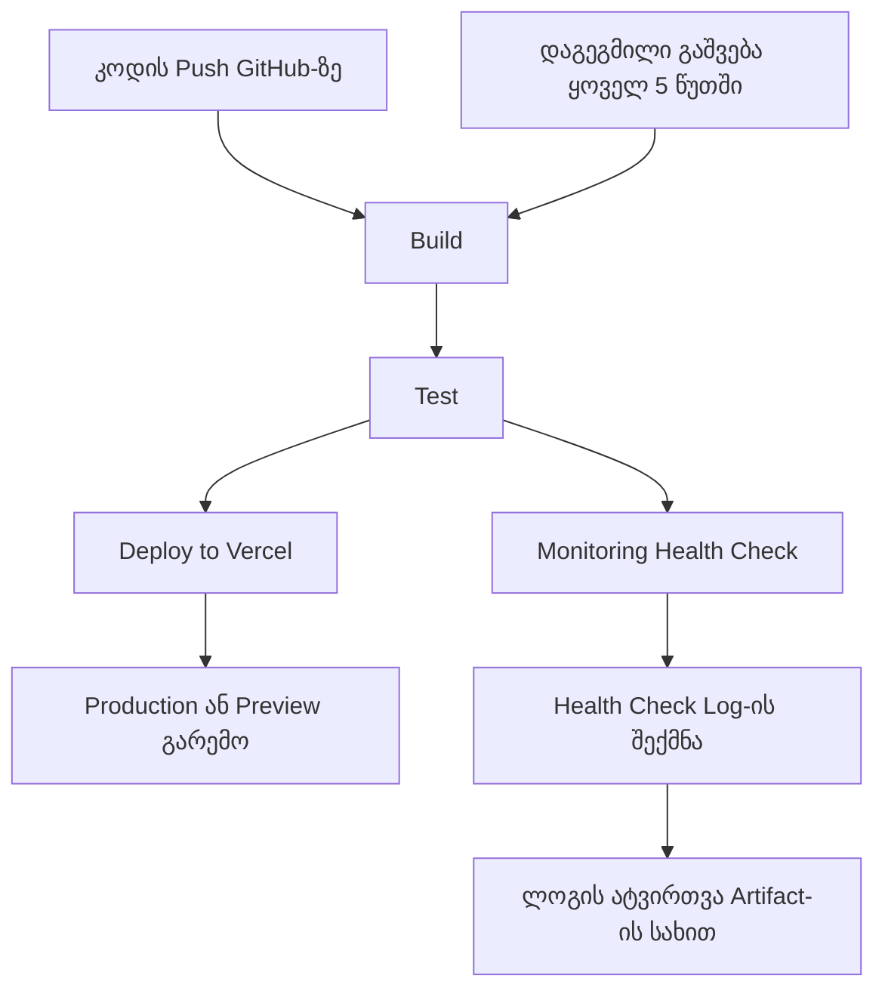
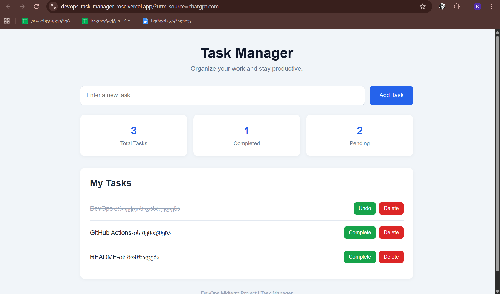
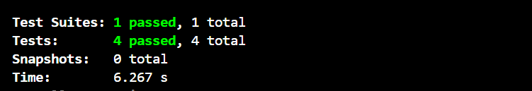
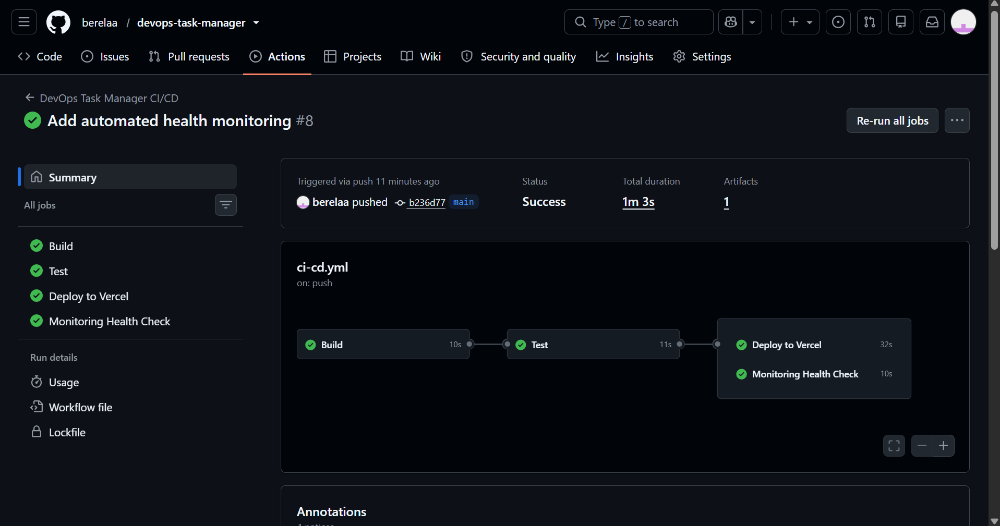

# DevOps Task Manager — დავალებების მართვის სისტემა

## 1. პროექტის აღწერა

DevOps Task Manager არის ვებაპლიკაცია, რომელიც მომხმარებელს საშუალებას აძლევს მართოს ყოველდღიური დავალებები.

პროექტის მთავარი მიზანია არა მხოლოდ ფუნქციური ვებაპლიკაციის შექმნა, არამედ DevOps-ის ძირითადი პრაქტიკების გამოყენება: ავტომატიზებული ტესტირება, CI/CD პროცესის აწყობა, აპლიკაციის განთავსება (Deployment) და მონიტორინგი (Monitoring).

აპლიკაციის საშუალებით შესაძლებელია:
- ახალი დავალებების დამატება.
- დავალების შესრულებულად მონიშვნა.
- დავალებების წაშლა.
- ყველა დავალების რაოდენობის ნახვა.
- შესრულებული და შეუსრულებელი დავალებების რაოდენობის ნახვა.
- მონაცემების შენახვა ბრაუზერის LocalStorage-ში.

## 2. გამოყენებული ტექნოლოგიები

პროექტის შესაქმნელად გამოყენებულია შემდეგი ტექნოლოგიები:

| ტექნოლოგია | დანიშნულება |
|---|---|
| HTML5 | ვებგვერდის სტრუქტურა |
| CSS3 | ვიზუალური დიზაინი და სტილები |
| JavaScript | აპლიკაციის ფუნქციონალი |
| Node.js | JavaScript-ის შესრულების გარემო |
| npm | პაკეტებისა და დამოკიდებულებების მართვა |
| Jest | ერთეულოვანი ტესტირება |
| Git | ვერსიების კონტროლი |
| GitHub | კოდის საცავი |
| GitHub Actions | CI/CD პროცესის ავტომატიზაცია |
| Vercel | აპლიკაციის განთავსება |

## 3. პროექტის სტრუქტურა

```text
devops-task-manager/
│
├── .github/
│   └── workflows/
│       └── ci-cd.yml
│
├── monitoring/
│   └── healthCheck.js
│
├── public/
│   ├── index.html
│   ├── style.css
│   └── script.js
│
├── scripts/
│   └── build.js
│
├── src/
│   └── taskManager.js
│
├── tests/
│   └── taskManager.test.js
│
├── package.json
├── package-lock.json
└── README.md
```

## 4. აპლიკაციის გაშვება ლოკალურად

პროექტის ლოკალურ კომპიუტერზე გასაშვებად საჭიროა შემდეგი ნაბიჯების შესრულება.

**1. რეპოზიტორიის კლონირება:**

```bash
git clone https://github.com/berelaa/devops-task-manager.git
```

**2. პროექტის საქაღალდეში გადასვლა:**

```bash
cd devops-task-manager
```

**3. საჭირო პაკეტების ინსტალაცია:**

```bash
npm install
```

**4. Build პროცესის გაშვება:**

```bash
npm run build
```

**5. ტესტების გაშვება:**

```bash
npm test
```

**6. აპლიკაციის გახსნა:**

გახსენით `public/index.html` ბრაუზერში.

## 5. CI/CD პროცესის აღწერა

პროექტში გამოყენებულია GitHub Actions, რომლის საშუალებითაც ავტომატიზებულია კოდის შემოწმების, ტესტირებისა და განთავსების პროცესები.

CI/CD Workflow შედგება ოთხი ძირითადი Job-ისგან:

### 5.1 Build — პროექტის აგება და შემოწმება

Build ეტაპზე სრულდება:
- GitHub რეპოზიტორიიდან კოდის მიღება.
- Node.js 24 გარემოს მომზადება.
- საჭირო დამოკიდებულებების ინსტალაცია.
- პროექტისთვის აუცილებელი ფაილების არსებობის შემოწმება.

თუ რომელიმე აუცილებელი ფაილი არ არსებობს, Build ეტაპი შეცდომით სრულდება.

### 5.2 Test — ავტომატიზებული ტესტირება

Test ეტაპზე გამოიყენება Jest ტესტირების ბიბლიოთეკა.

მოწმდება შემდეგი ფუნქციები:
- ახალი დავალების დამატება.
- დავალების შესრულებულად მონიშვნა.
- დავალების წაშლა.
- ცარიელი დავალების დამატების აკრძალვა.

Test ეტაპი იწყება მხოლოდ Build ეტაპის წარმატებით დასრულების შემდეგ.

### 5.3 Deploy — აპლიკაციის განთავსება

Deploy ეტაპზე გამოიყენება Vercel.

განთავსების პროცესი ავტომატიზებულია:
- `main` Branch-ზე Push-ის შემთხვევაში აპლიკაცია ქვეყნდება Production გარემოში.
- `dev` Branch-ზე Push-ის შემთხვევაში იქმნება Preview Deployment.

Deploy ეტაპი სრულდება მხოლოდ Build და Test ეტაპების წარმატებით დასრულების შემდეგ.

Vercel-თან კავშირისთვის გამოყენებულია GitHub Secrets, სადაც უსაფრთხოდ ინახება საჭირო ავტორიზაციის მონაცემები.

### 5.4 Monitoring — აპლიკაციის მონიტორინგი

Monitoring ეტაპი პასუხისმგებელია განთავსებული აპლიკაციის ხელმისაწვდომობის შემოწმებაზე.

გამოიყენება `monitoring/healthCheck.js` სკრიპტი, რომელიც:
- აგზავნის HTTP მოთხოვნას აპლიკაციის მისამართზე.
- ამოწმებს HTTP პასუხის სტატუსს.
- წარმატებული პასუხის შემთხვევაში აფიქსირებს `UP` სტატუსს.
- შეცდომის შემთხვევაში აფიქსირებს `DOWN` სტატუსს.
- შედეგებს წერს `health-check.log` ფაილში.
- ლოგის ფაილს ინახავს GitHub Actions Artifact-ის სახით.

Monitoring ავტომატურად სრულდება Push-ის დროს და დაგეგმილი განრიგით — ყოველ 5 წუთში.

## 6. CI/CD Workflow-ის დიაგრამა



## 7. მონიტორინგის ლოკალურად გაშვება

მონიტორინგის სკრიპტის ლოკალურად გასაშვებად გამოიყენეთ ბრძანება:

```bash
node monitoring/healthCheck.js
```

შედეგი ჩაიწერება ფაილში:

```text
monitoring/health-check.log
```

ლოგის მაგალითი:

```text
2026-11-03T14:39:35.878Z | UP | HTTP 200
```

ლოგში ფიქსირდება შემოწმების დრო, აპლიკაციის სტატუსი და HTTP პასუხის კოდი ან შეცდომის შეტყობინება.

## 8. ტესტირების შედეგები

პროექტში გამოყენებულია Jest.

შემუშავებულია 4 ერთეულოვანი ტესტი:

1. ახალი დავალების წარმატებით დამატება.
2. დავალების სტატუსის შეცვლა.
3. დავალების წაშლა.
4. ცარიელი დავალების დამატების უარყოფა.

ტესტების გაშვების ბრძანება:

```bash
npm test
```

წარმატებული შესრულებისას მოსალოდნელი შედეგია:

```text
Test Suites: 1 passed, 1 total
Tests:       4 passed, 4 total
```

## 9. პროექტის განთავსება

აპლიკაცია განთავსებულია Vercel პლატფორმაზე.

**აპლიკაციის მისამართი:**

https://devops-task-manager-rose.vercel.app

**GitHub რეპოზიტორია:**

https://github.com/berelaa/devops-task-manager


## 10. Screenshots — პროექტის ვიზუალური მტკიცებულებები

### 10.1 აპლიკაციის მთავარი გვერდი



### 10.2 Jest Unit Tests



### 10.3 GitHub Actions CI/CD Pipeline



## 11. დასკვნა

პროექტის ფარგლებში შეიქმნა ფუნქციური ვებაპლიკაცია და განხორციელდა DevOps-ის ძირითადი პროცესების ავტომატიზაცია.

GitHub Actions-ის გამოყენებით აწყობილია CI/CD Pipeline, რომელიც უზრუნველყოფს კოდის ავტომატურ შემოწმებას, ტესტირებასა და აპლიკაციის განთავსებას.

ასევე დამატებულია Monitoring მექანიზმი, რომელიც პერიოდულად ამოწმებს აპლიკაციის ხელმისაწვდომობას და ინახავს შემოწმების შედეგებს.

პროექტმა საშუალება მომცა პრაქტიკულად გამომეყენებინა Git, GitHub, Jest, GitHub Actions და Vercel ტექნოლოგიები.

## Live Demo

- **Task Manager:** https://devops-task-manager-rose.vercel.app
- **Monitoring Dashboard:** https://devops-task-manager-rose.vercel.app/monitoring.html
- **GitHub Repository:** https://github.com/berelaa/devops-task-manager

---

**ავტორი:** გიორგი ბერელიძე  
**პროექტი:** DevOps Task Manager
